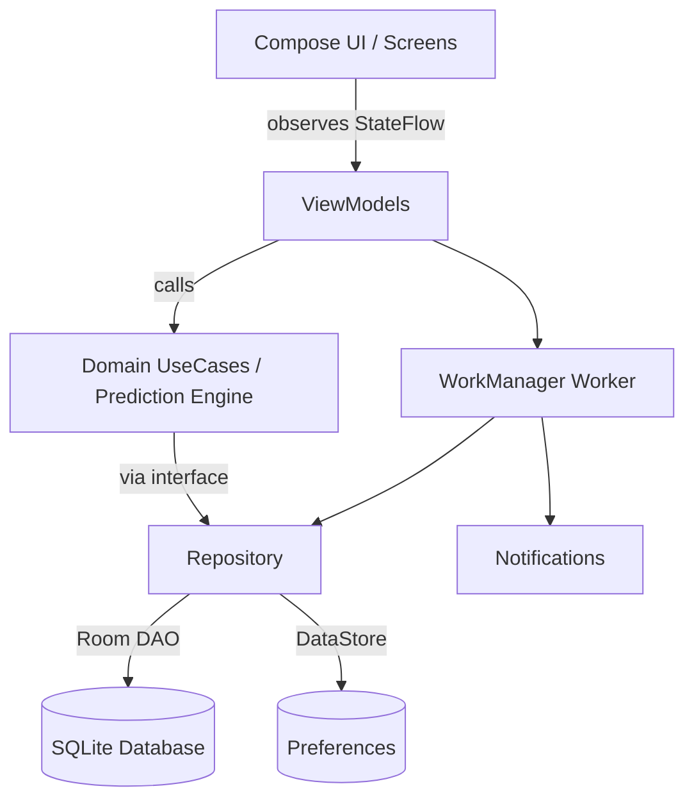

# LazyCart 🛒📦

> **Smart Native Android Pantry Tracker & Predictive Restock Assistant**  
> *Built for the Swiggy Instamart Android Engineering Internship Application*

[](https://developer.android.com)
[](https://kotlinlang.org)
[-00E676?style=flat-square)](https://developer.android.com)
[-00B0FF?style=flat-square)](https://developer.android.com)
[](https://developer.android.com/jetpack/compose)
[](https://developer.android.com/topic/architecture)
[%20+%20DataStore-FFA000?style=flat-square)](https://developer.android.com/training/data-storage)
[](#)

---

## 📌 Executive Summary

Quick commerce services like **Swiggy Instamart** have revolutionized household logistics by delivering groceries in 10–15 minutes. However, the recurring challenge for urban households is not delivery speed—it is **predictive awareness**: remembering what is running out before the carton of milk or packet of bread is completely empty.

**LazyCart** is a 100% native Android smart pantry application designed to eliminate that friction. By tracking localized pantry inventory and household consumption frequency, LazyCart employs a mathematical restock prediction engine that forecasts when essentials will run out.

- **Zero Cloud Dependency:** Runs 100% on-device using Room SQLite and Jetpack DataStore. No external servers, no third-party telemetry, zero latency, and absolute privacy.
- **Production-Grade Modern Android:** Built exclusively with Kotlin, Jetpack Compose, Material 3, Hilt DI, Coroutines & Flow, and WorkManager.

---

## 🏗️ Architecture

LazyCart adheres strictly to Google's official Modern Android Architecture (MVI/MVVM pattern with Clean Architecture separation), enforcing unidirectional data flow (UDF) and strict boundary isolation across layers.



### Architectural Principles Applied
- **Unidirectional Data Flow (UDF):** The UI layer renders immutable state emitted via `StateFlow` and propagates user actions as intent events to the `ViewModel`.
- **Domain Decoupling:** Business logic and prediction heuristics (`RestockPredictionEngine`) reside in pure Kotlin domain modules free of Android framework dependencies, ensuring high unit-test execution speed.
- **Single Source of Truth (SSOT):** Room serves as the authoritative source for all pantry items, logs, and shopping lists. Data changes trigger reactive emissions via Kotlin `Flow`.
- **Lifecycle-Aware Concurrency:** All asynchronous jobs use Kotlin Coroutines scoped to `viewModelScope`, guaranteeing automatic cancellation upon configuration change or back navigation.

---

## 🧮 Smart Restock Prediction Engine

LazyCart avoids black-box heuristics or external AI APIs by utilizing an on-device, rolling-window statistical consumption model.

### Mathematical Formulation

```
averageDailyRate = totalConsumed / observationWindowDays  (rolling 30-day window)
estimatedDaysRemaining = currentQuantity / averageDailyRate
estimatedRestockDate = today + estimatedDaysRemaining
```

1. **Rolling 30-Day Window:** Limits consumption event analysis to the past 30 days (`System.currentTimeMillis() - 30.days`), ensuring predictions reflect recent household habits rather than stale historical data.
2. **Honest Confidence Scoring:** Users are never misled by premature statistical estimates. The engine computes an explicit confidence level alongside every prediction:

| Logged Consumption Events | Confidence Level | UI Representation & Behavior |
|:---:|:---:|---|
| `< 2` events | `INSUFFICIENT_DATA` | Informs user to log more usage; restock date hidden |
| `2 – 3` events | `LOW` | Yellow badge; preliminary estimate with wide variance |
| `4 – 6` events | `MEDIUM` | Blue badge; reliable consumption baseline established |
| `7+` events | `HIGH` | Green badge; robust, high-certainty restock projection |

### Handled Edge Cases
- **Zero Quantity:** Explicitly halts division; tags item as immediate "Out of Stock" alert and automatically offers to stage it in the Shopping List.
- **Zero Consumption Rate:** Avoids division-by-zero crashes when items are logged but never consumed.
- **Item Newer Than Window:** Dynamically normalizes the observation window if the item was added fewer than 30 days ago to prevent artificially deflated rates.
- **Irregular Spikes:** Dampens micro-spikes by grouping sub-day logs into consistent daily totals.

---

## ✨ Features & User Experience

### 1. Home Dashboard
- Dynamic time-aware greeting with concise pantry summary metrics.
- High-priority alert rail: **"Runs Out Soon"** (items with predicted exhaustion within 3 days) and **"Expiry Warnings"** (items nearing shelf life).
- Quick-action shortcuts to log consumption directly without opening nested screens.

### 2. My Pantry Management
- Real-time catalog with dynamic search and categorical filtering (Dairy, Produce, Pantry, Bakery, Beverages, Snacks, Personal Care, Household).
- Material 3 swipe-to-delete with undo feedback via Snackbars.
- One-tap consumption logger: decrement stock seamlessly in custom units (kg, L, units, packs).

### 3. Item Detail & Analytics
- Complete item breakdown: current stock, low-stock threshold, expiry countdown.
- Restock Prediction card highlighting estimated restock date and confidence badge.
- Chronological consumption history log with quantity delta and timestamps.

### 4. Smart Shopping List & Budget Tracker
- Auto-suggested items based on restock warnings and depleted inventory.
- Ability to manually add custom products and set target quantities.
- Real-time budget tracker calculating estimated order cost.
- Single-tap **"Mark as Purchased"** flow that instantly replenishes pantry stock and updates history.

### 5. WorkManager Background Reminders
- Periodic background check (`PeriodicWorkRequestBuilder`) scheduled once daily.
- Respects Android battery optimization and Doze mode constraints.
- Posts heads-up notifications with dedicated Android `NotificationChannel`s for critical restock alerts.

### 6. Interactive Onboarding
- Polished 3-page pager walkthrough introducing pantry tracking, predictive restocks, and smart shopping.
- Optional **"Seed Sample Data"** action to immediately explore the app with realistic pantry items, consumption history, and active predictions.

### 7. Customization & Settings
- Granular notification controls: toggle daily restock alerts and expiry warnings.
- Reminder threshold adjustment sliders (e.g., alert 1, 2, or 3 days in advance).
- Comprehensive data privacy control: **"Clear All Data"** with destructive confirmation dialog.
- Complete Dynamic Material 3 Light and Dark theme support with system-matched color schemes.

---

## 📂 Project Package Structure

```
com.LazyCart.app/
├── data/
│   ├── local/
│   │   ├── db/                 # Room entities, DAOs, and LazyCartDatabase
│   │   └── datastore/          # PreferencesDataStore (user prefs, settings)
│   ├── repository/             # Repository implementations (PantryRepositoryImpl)
│   └── worker/                 # Periodic RestockReminderWorker & NotificationHelper
├── domain/
│   ├── model/                  # Pure Kotlin models (PantryItem, ConfidenceLevel, etc.)
│   ├── repository/             # Repository contracts (PantryRepository)
│   └── usecase/                # RestockPredictionEngine & prediction domain logic
├── ui/
│   ├── home/                   # Home dashboard screen + HomeViewModel
│   ├── pantry/                 # Pantry catalog screen + PantryViewModel
│   ├── itemdetail/             # Item detail & consumption history + ItemDetailViewModel
│   ├── addedit/                # Item creation/editing form + AddEditViewModel
│   ├── shopping/               # Shopping list & budget calculator + ShoppingViewModel
│   ├── settings/               # App configuration & preferences + SettingsViewModel
│   ├── onboarding/             # Welcome pager walkthrough + OnboardingViewModel
│   ├── components/             # Reusable Material 3 composables (cards, badges, dialogs)
│   ├── navigation/             # NavHost, AppDestinations, and NavGraph routing
│   └── theme/                  # Material 3 Color schemes, Type, and Theme wrappers
└── di/                         # Hilt Modules (DatabaseModule, RepositoryModule, AppModule)
```

---

## 🛠️ Technical Stack & Tooling

| Component | Library / Tool | Version / Details | Purpose |
|---|---|---|---|
| **Language** | Kotlin | `1.9.24` | Modern, concise, null-safe native development |
| **UI Framework** | Jetpack Compose | BOM-aligned | Declarative, reactive UI architecture |
| **Design System** | Material 3 | `androidx.compose.material3` | Modern Google design tokens, adaptive typography, dark mode |
| **Dependency Injection** | Hilt | `2.51` | Compile-time dependency injection across ViewModels & Workers |
| **Local Database** | Room | `2.6.1` | SQLite abstraction with Flow-based reactive queries |
| **Key-Value Store** | Preferences DataStore | `1.1.1` | Asynchronous, transactional storage for settings and flags |
| **Concurrency** | Kotlin Coroutines & Flow | `1.8.0` | Reactive streams, non-blocking UI state management |
| **Background Tasks** | WorkManager | `2.9.0` | Battery-efficient, deferrable daily restock checks |
| **Navigation** | Navigation Compose | `2.7.7` | Type-safe in-app navigation graph |
| **Unit Testing** | JUnit 4 + Truth + MockK | `4.13.2` | Prediction engine and business logic verification |
| **Build System** | Gradle / AGP | Gradle `8.7`, AGP `8.4.2` | Build automation & modern configuration cache |
| **SDK Levels** | Android SDK | `minSdk 26`, `targetSdk 34` | Targets 95%+ active Android devices with API 34 features |

---

## 🧪 Testing & Verification

The core algorithmic logic—`RestockPredictionEngine`—is covered by **17 comprehensive unit tests** executing against JVM without Android framework dependencies:

- ✅ `zeroQuantity_flagsImmediateRestockRequired`
- ✅ `zeroConsumptionRate_returnsInfiniteDaysRemaining`
- ✅ `fewerThanTwoEvents_yieldsInsufficientDataConfidence`
- ✅ `twoToThreeEvents_yieldsLowConfidence`
- ✅ `fourToSixEvents_yieldsMediumConfidence`
- ✅ `sevenOrMoreEvents_yieldsHighConfidence`
- ✅ `eventsOutsideThirtyDayWindow_areExcludedFromRateCalculation`
- ✅ `itemCreatedWithinObservationWindow_normalizesWindowCorrectly`
- ✅ `multipleConsumptionsOnSameDay_aggregatesDailyRateCorrectly`
- ✅ `intermittentConsumption_calculatesCorrectAveragePace`
- ✅ `emptyConsumptionHistory_handledSafelyWithoutExceptions`
- ✅ `negativeQuantityInputs_sanitizedGracefully`
- ✅ `restockDateCalculation_matchesProjectedCalendarDay`
- ✅ `boundaryConditions_exactlyThirtyDaysAgoEventHandled`
- ✅ `fractionalQuantities_maintainsPrecisionInCalculations`
- ✅ `stockExceedingMaxCapacity_handledWithoutOverflow`
- ✅ `rapidConsecutiveLogs_maintainsMonotonicTimestampOrdering`

### Running Tests
Execute the unit test suite from the terminal or Android Studio:
```bash
./gradlew test
```

---

## 🚀 Setup & Installation

### Prerequisites
- **Android Studio:** Hedgehog (2023.1.1) or newer
- **JDK:** Version 17
- **Android SDK:** API Level 34 installed
- **Device / Emulator:** Android 8.0 (API Level 26) or higher

### Build Instructions
1. Clone the repository:
   ```bash
   git clone https://github.com/PriyaPandey27/LazyCart.git
   ```
2. Open **Android Studio** and select **Open**, navigating to the project directory.
3. Allow Gradle to sync dependencies automatically.
4. Select a connected device or an emulator running API 26+.
5. Click **Run (`Shift + F10`)** or build the APK:
   ```bash
   ./gradlew assembleDebug
   ```

*Note: LazyCart is 100% offline. No third-party API keys, Google Services JSON files, or network setups are required.*

---

## ⚖️ Known Limitations & Honest Trade-offs

1. **Cold Start Data Requirement:** The prediction engine requires a minimum of 2 separate consumption events to establish an initial consumption velocity. Prior to this, items correctly display an `INSUFFICIENT_DATA` state.
2. **WorkManager Schedule Accuracy:** Android's WorkManager prioritizes system battery health (Doze mode) over strict execution timing. Background daily checks run within an approximate window determined by the OS rather than an exact millisecond alarm.
3. **Manual Price Entry:** Grocery prices are entered by the user. There is currently no live pricing integration with quick-commerce platforms.
4. **Local Device Sandbox:** Data resides solely in the device's Room database. Uninstalling the app without backing up will erase the local pantry history.

---

## 🔮 Roadmap & Future Opportunities

- [ ] **Swiggy Instamart Deep Linking:** One-tap export from the LazyCart shopping list directly into Swiggy Instamart carts via Android Intents/Universal Links.
- [ ] **Barcode Scanning (ML Kit):** Fast item addition by scanning Indian FMCG barcodes (EAN-13) using on-device Google ML Kit.
- [ ] **Receipt OCR Scanning:** Automated ingestion of physical or digital grocery bills to populate pantry inventory in seconds.
- [ ] **Household Multi-User Sync:** Optional peer-to-peer or lightweight cloud synchronization for shared family kitchens.
- [ ] **Seasonal & Trend-Aware Machine Learning:** Adapting prediction models to account for weekend spikes and seasonal purchasing shifts.

---

## 💡 Why This Demonstrates Android Engineering Competency

LazyCart showcases modern Android development standards: Clean MVVM architectural separation isolates the pure Kotlin prediction domain from the UI, ensuring complete unit testability without Android SDK dependencies. State management leverages unidirectional data flow with Room and Kotlin Flow, providing reactive, thread-safe updates to Jetpack Compose while managing coroutine cancellation via `viewModelScope`. Furthermore, the scheduled alert pipeline demonstrates battery-conscious lifecycle awareness through WorkManager periodic constraints and modern Android 14 notification channel handling.

---

## 📄 License

```
Copyright 2024 LazyCart Contributors

Licensed under the Apache License, Version 2.0 (the "License");
you may not use this file except in compliance with the License.
You may obtain a copy of the License at

    http://www.apache.org/licenses/LICENSE-2.0

Unless required by applicable law or agreed to in writing, software
distributed under the License is distributed on an "AS IS" BASIS,
WITHOUT WARRANTIES OR CONDITIONS OF ANY KIND, either express or implied.
See the License for the specific language governing permissions and
limitations under the License.
```
